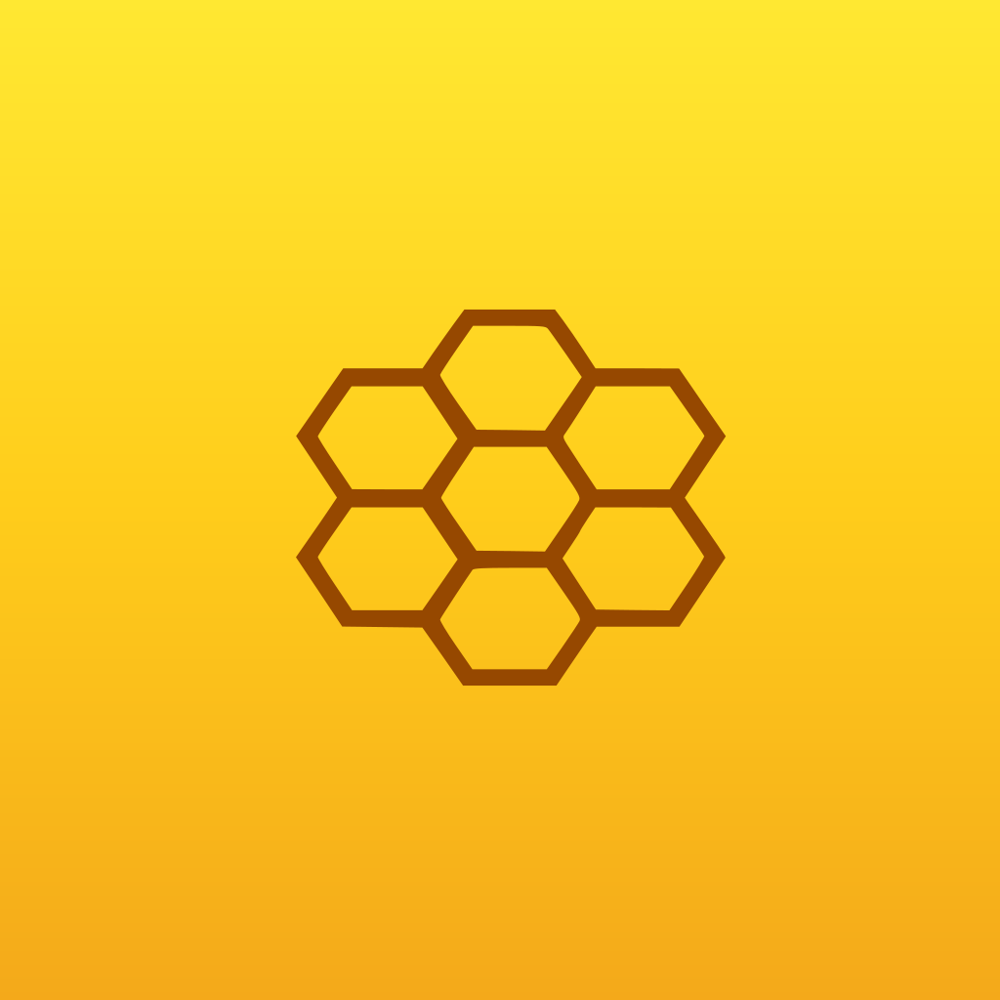

<div align="center">



# Fhive

**Aplicativo mobile para controle e monitoramento de uma casa inteligente (IoT).**

Trabalho de Conclusão de Curso (TCC)


</div>

---

## Sumário

1. [Sobre o projeto](#1-sobre-o-projeto)
2. [Problema e objetivos](#2-problema-e-objetivos)
3. [Funcionalidades](#3-funcionalidades)
4. [Arquitetura](#4-arquitetura)
5. [Tecnologias](#5-tecnologias)
6. [Estrutura de pastas](#6-estrutura-de-pastas)
7. [Design system](#7-design-system)
8. [Como executar](#8-como-executar)
9. [Integração com o backend](#9-integração-com-o-backend)
10. [Testes e qualidade de código](#10-testes-e-qualidade-de-código)
11. [Estado atual e limitações](#11-estado-atual-e-limitações)
12. [Roadmap](#12-roadmap)
13. [Equipe](#13-equipe)
14. [Documentação complementar](#14-documentação-complementar)
15. [Licença](#15-licença)

---

## 1. Sobre o projeto

O **Fhive** é o aplicativo mobile de um sistema de automação residencial. Ele permite que o morador cadastre dispositivos IoT (TVs, ar-condicionado, lâmpadas, câmeras, tomadas inteligentes e sensores), organize-os por cômodo, acompanhe indicadores de consumo e uso e crie rotinas de automação.

O app é o cliente de uma API REST própria, desenvolvida no projeto **`BackEnd_Fhive_Web`** (banco de dados MongoDB), responsável por autenticação, persistência de dispositivos e rotinas e recebimento de telemetria.

> **Nome do projeto:** Fhive · **Pacote Dart:** `tcc_mobile` · **Versão:** `1.0.0+1`

## 2. Problema e objetivos

> 📝 **Adapte esta seção ao texto da monografia.** O conteúdo abaixo é uma base a partir do que o aplicativo implementa.

### Problema

Soluções de casa inteligente costumam ser fragmentadas: cada fabricante oferece um aplicativo próprio, o que dificulta o controle unificado dos dispositivos, a visualização do consumo de energia e a criação de rotinas entre aparelhos diferentes.

### Objetivo geral

Desenvolver um aplicativo mobile multiplataforma que centralize o cadastro, o controle e o monitoramento de dispositivos IoT residenciais, integrado a um backend próprio.

### Objetivos específicos

- Implementar autenticação segura (cadastro com confirmação por e-mail, login com JWT e recuperação de senha por código).
- Permitir o cadastro de dispositivos em etapas, com identificação, características, conexão e revisão.
- Organizar os aparelhos por cômodo e permitir marcar favoritos para acesso rápido.
- Exibir controles específicos para cada tipo de aparelho.
- Apresentar indicadores de energia, tempo de uso, pontuação e eficiência por meio de gráficos.
- Permitir a criação e o gerenciamento de rotinas de automação.
- Padronizar a interface com um design system único (cores, tipografia, espaçamentos e componentes).

## 3. Funcionalidades

| Módulo | O que o app oferece |
| --- | --- |
| **Onboarding** | Tela inicial com acesso a *Entrar* e *Criar conta* e tutorial de primeiros passos. |
| **Autenticação** | Cadastro com confirmação de e-mail por código, login (JWT), recuperação e redefinição de senha por código, indicador de força da senha em quatro níveis. |
| **Home** | Resumo da casa e seção de **Favoritos**, com acesso direto aos controles do aparelho. |
| **Aparelhos** | Listagem agrupada por cômodo (somente cômodos com dispositivos), seções recolhíveis, filtro por local, criação de locais personalizados e favoritos por estrela. |
| **Cadastro de aparelho** | Pop-up em 4 etapas: **Identificação → Características → Conexão (Wi-Fi, Bluetooth ou Ethernet) → Revisão**, com validação de nome e ID e bloqueio de duplicados. |
| **Detalhes do aparelho** | Controles adaptados ao tipo: TV, ar-condicionado, lâmpada, câmera, tomada inteligente, sensor e genérico. |
| **Gráficos** | Visão por aparelho com seis telas de detalhe: gasto de energia, horas de uso, pontuação de gestão, histórico, informações específicas e eficiência. |
| **Rotinas** | Listagem, criação, ativação/desativação e exclusão de rotinas, com horários e dias da semana. |
| **Conta e configurações** | Edição de perfil (nome, e-mail e senha), preferências locais, central de ajuda e logout. |
| **Navegação** | Barra inferior e navegação por gesto horizontal entre as cinco abas principais. |

### Rotas do aplicativo

| Rota | Tela |
| --- | --- |
| `/inicio` | Tela inicial (rota inicial do app) |
| `/entrar` | Login |
| `/cadastrar` | Cadastro |
| `/home` | Home e favoritos |
| `/aparelhos` | Aparelhos por cômodo |
| `/graficos` | Gráficos e indicadores |
| `/rotinas` | Rotinas de automação |
| `/configuracoes` | Configurações |
| `/conta` | Perfil e segurança |
| `/ajuda` | Central de ajuda |

## 4. Arquitetura

O projeto segue a organização **feature-first**: cada funcionalidade possui suas telas (`presentation`) e, quando consome a API, sua camada de acesso a dados (`data`). Código transversal fica em `core` e `shared`.

```text
┌─────────────────────────┐   HTTP / JSON (JWT)   ┌─────────────────────┐        ┌───────────┐
│  Fhive (Flutter)        │ ────────────────────▶ │  BackEnd_Fhive_Web  │ ─────▶ │  MongoDB  │
│                         │ ◀──────────────────── │  API REST           │        └───────────┘
│  presentation           │                       │                     │        ┌───────────┐
│    └─ telas e widgets   │                       │                     │ ◀───── │ Dispositivos │
│  shared/state           │                       └─────────────────────┘  MQTT  │ IoT       │
│    └─ stores (estado)   │                                                      └───────────┘
│  features/*/data        │
│    └─ clientes da API   │
│  core/network           │
│    └─ ApiClient         │
└─────────────────────────┘
```

**Decisões principais**

- **Cliente HTTP único** (`ApiClient`): centraliza URL base, cabeçalho `Authorization: Bearer`, *timeout* de 20 s, decodificação de JSON e conversão de erros HTTP em mensagens legíveis (`ApiException`). Um `401` limpa o token e informa que a sessão expirou.
- **Estado compartilhado com `ValueNotifier`** (`shared/state`): `AuthStore`, `AparelhosStore`, `RotinasStore` e `PreferenciasStore`, sem dependência de pacotes externos de gerenciamento de estado.
- **Camada `data` por feature:** `AuthApi`, `DispositivosApi`, `RotinasApi` e `EquipesApi` isolam os endpoints das telas.
- **Design system único** em `core/theme/theme.dart`: nenhuma tela declara cores, raios ou tamanhos de fonte fixos.

## 5. Tecnologias

| Item | Versão / pacote |
| --- | --- |
| Linguagem | Dart `^3.12.2` |
| Framework | Flutter (Material 3) |
| HTTP | [`http`](https://pub.dev/packages/http) `^1.6.0` |
| SVG | [`flutter_svg`](https://pub.dev/packages/flutter_svg) `^2.0.17` |
| Ícones | [`cupertino_icons`](https://pub.dev/packages/cupertino_icons) `^1.0.8` |
| Lint | [`flutter_lints`](https://pub.dev/packages/flutter_lints) `^6.0.0` |
| Testes | `flutter_test` (SDK) |
| Fontes | Arvo (títulos) e Montserrat (corpo) |
| Backend | `BackEnd_Fhive_Web` (API REST + MongoDB) |

## 6. Estrutura de pastas

```text
.
├── lib/
│   ├── main.dart                         # Ponto de entrada, tema e rotas nomeadas
│   ├── core/
│   │   ├── network/api_client.dart       # Cliente HTTP único e ApiException
│   │   └── theme/theme.dart              # Design system (AppColors, AppTextStyles, AppTheme...)
│   ├── shared/
│   │   ├── state/                        # AuthStore, AparelhosStore, RotinasStore, PreferenciasStore
│   │   └── widgets/                      # Barra de navegação, cabeçalho, diálogos, logo, gestos
│   └── features/
│       ├── auth/                         # tela_inicial, entrar, cadastrar  +  data/auth_api
│       ├── onboarding/                   # tela_tutorial
│       ├── home/                         # home (favoritos)
│       ├── devices/                      # aparelhos, criar_aparelho, aparelho_detalhes  +  data/dispositivos_api
│       ├── analytics/                    # graficos, indicador_grafico_detalhe
│       ├── routines/                     # rotinas, formulario_rotina  +  data/rotinas_api
│       ├── teams/                        # data/equipes_api (sem tela ainda)
│       └── settings/                     # configuracoes, conta, ajuda
├── test/                                 # widget_test.dart, navegacao_por_deslize_test.dart
├── assets/images/                        # logo.svg, fhive_app_icon.png, fhive_app_icon.svg
├── android/  ios/  web/  windows/  macos/  linux/
├── pubspec.yaml
└── analysis_options.yaml
```

## 7. Design system

Todo o visual vem de [`lib/core/theme/theme.dart`](lib/core/theme/theme.dart). As telas **devem usar somente esses tokens**.

| Token | Uso |
| --- | --- |
| `AppColors` | Marrom principal `#964800`, fundo em gradiente amarelo (`#FFE832` → `#FFCD1B` → `#F4A91A`), cartões em creme `#FFFEF0`, cores de sucesso, alerta e erro. |
| `AppTextStyles` | Escala tipográfica: 40 · 24 · 19 · 16 · 14 · 12. |
| `AppSpacing` | `xs 4`, `sm 8`, `md 12`, `lg 16`, `xl 24`. |
| `AppRadius` | Cartão `18`, botão `14`, chip `12`, painel grande `22`. |
| `AppTheme` | Botões, campos, chips, diálogos, AppBar, snackbars e transição suave entre telas. |

Novas telas devem ser criadas em `lib/features/<feature>/presentation/`.

## 8. Como executar

### Pré-requisitos

- [Flutter SDK](https://docs.flutter.dev/get-started/install) com Dart `^3.12.2`
- Android Studio (Android SDK e emulador) **ou** um celular físico com depuração USB
- Backend `BackEnd_Fhive_Web` em execução (veja a [seção 9](#9-integração-com-o-backend))
- Git

Confira o ambiente com:

```bash
flutter doctor
```

### Passo a passo

```bash
# 1. Clonar a branch de desenvolvimento
git clone -b padronizacao-design https://github.com/HigorLed/Fhive_flutter.git
cd Fhive_flutter

# 2. Instalar as dependências
flutter pub get

# 3. Executar (emulador Android: a API padrão é http://10.0.2.2:3000)
flutter run
```

### Fontes (Arvo e Montserrat)

O app referencia as famílias `Arvo` e `Montserrat`, mas os arquivos `.ttf` **ainda não estão no repositório** e o bloco `fonts:` do `pubspec.yaml` está comentado. Sem isso, o Flutter usa a fonte padrão do sistema. Para ativar:

1. Baixe as fontes em [fonts.google.com](https://fonts.google.com) (Arvo e Montserrat).
2. Coloque os arquivos em `assets/fonts/`.
3. Descomente o bloco `fonts:` no `pubspec.yaml`, conferindo se os nomes dos arquivos batem.
4. Rode `flutter pub get`.

### Outras plataformas

```bash
flutter run -d windows    # Windows
flutter run -d chrome     # Web
flutter devices           # lista os dispositivos disponíveis
```

### Gerar build de release (Android)

```bash
flutter build apk --release
# saída: build/app/outputs/flutter-apk/app-release.apk
```

## 9. Integração com o backend

O app consome a API REST do projeto **`BackEnd_Fhive_Web`**.

### Subindo o backend

1. Siga o README do repositório `BackEnd_Fhive_Web`.
2. Copie o arquivo de ambiente e configure as variáveis (MongoDB, JWT, SMTP):
   - Linux/macOS: `cp .env.example .env`
   - Windows/PowerShell: `Copy-Item .env.example .env`
3. Confirme que o MongoDB está acessível e que o servidor responde na porta `3000`.

> O **cadastro** e a **recuperação de senha** dependem de um **SMTP funcional** no backend, pois o código de confirmação é enviado por e-mail.

### URL da API

A URL base é definida em `lib/core/network/api_client.dart`. Ordem de prioridade:

1. Valor de `--dart-define=FHIVE_API_BASE_URL=...`
2. Padrão por plataforma:

| Plataforma | URL padrão |
| --- | --- |
| Emulador Android | `http://10.0.2.2:3000` |
| Web, iOS, desktop | `http://localhost:3000` |

Para **celular físico** ou servidor remoto, informe a URL:

```bash
flutter run --dart-define=FHIVE_API_BASE_URL=http://192.168.0.10:3000
```

Substitua `192.168.0.10` pelo IP do computador na rede local. O celular e o computador precisam estar na mesma rede e o firewall deve liberar a porta do backend. **Use HTTPS fora do ambiente de desenvolvimento.**

### Endpoints consumidos

| Recurso | Método e rota | Finalidade |
| --- | --- | --- |
| **Usuários** | `POST /usuarios` | Iniciar cadastro |
| | `POST /usuarios/confirmarEmail` | Confirmar e-mail com código |
| | `POST /usuarios/login` | Login (retorna JWT) |
| | `GET /usuarios/perfil` | Consultar perfil |
| | `PATCH /usuarios/perfil` | Atualizar nome, e-mail, foto e senha |
| | `GET /usuarios` | Listar usuários |
| | `POST /usuarios/esqueci-senha` | Solicitar código de recuperação |
| | `POST /usuarios/verificar-codigo-recuperacao` | Validar código |
| | `POST /usuarios/redefinir-senha` | Definir nova senha |
| **Dispositivos** | `GET /dispositivos` | Listar |
| | `POST /dispositivos` | Cadastrar (`nome`, `tipo`, `deviceId`, `local`, `fabricante`, `modelo`, `conexao`) |
| | `GET /dispositivos/:id` | Consultar |
| | `GET /dispositivos/:id/telemetrias` | Leituras de telemetria |
| | `DELETE /dispositivos/:id` | Excluir |
| **Rotinas** | `GET /rotinas` · `POST /rotinas` | Listar e criar |
| | `GET /rotinas/:id` · `PUT /rotinas/:id` | Consultar e atualizar (inclui ativar/desativar) |
| | `DELETE /rotinas/:id` | Excluir |
| **Equipes** | `GET /equipes` · `POST /equipes` · `DELETE /equipes/:id` | Camada de API pronta, **sem tela** |

O `deviceId` (identificador do hardware) é mantido separado do `id` interno do registro no MongoDB.

### Regras de senha

Mínimo de **8 caracteres**, com letra maiúscula, letra minúscula, número e caractere especial. A regra é validada no app e nos controllers do backend.

## 10. Testes e qualidade de código

Os testes de widget usam um **cliente HTTP simulado** (`ApiClient.usarCliente`), então rodam sem MongoDB, SMTP ou backend ativo.

```bash
dart format lib test        # formatação
flutter analyze             # análise estática (flutter_lints)
flutter test                # toda a suíte
flutter test --plain-name "nome do teste"   # um teste específico
```

**Cobertura atual**

- Abertura na tela inicial, login via API e navegação pela barra inferior.
- Cadastro IoT em quatro etapas, favoritos, detalhes por tipo e telas de indicadores.
- Perfil e ajuda.
- `AuthStore` (cadastro, autenticação e atualização de dados), recuperação de senha, preferências, `AparelhosStore` e `RotinasStore`.
- Navegação por gesto horizontal (`test/navegacao_por_deslize_test.dart`).

> O histórico de validações e correções está em [`README_CORRECOES.md`](README_CORRECOES.md). Rode a suíte localmente antes de cada entrega.

## 11. Estado atual e limitações

O projeto é um **protótipo funcional integrado ao backend**. Limitações conhecidas, registradas de forma transparente:

- **Sessão:** o token JWT fica apenas em memória e é descartado ao fechar o app; não há persistência segura da sessão entre execuções.
- **Controle físico:** os controles de TV, ar-condicionado e demais aparelhos **não enviam comandos ao hardware**. A API ainda não possui endpoint de comando nem de execução de rotina sob demanda.
- **Conexão:** o botão *Testar* do cadastro valida apenas os dados preenchidos; não há pareamento, descoberta de dispositivos nem comunicação MQTT/HTTP com o hardware pelo app.
- **Gráficos:** consultam telemetria real quando existe. Sem leituras MQTT, parte dos indicadores é **demonstrativa** e sinalizada na tela.
- **Dados locais:** favoritos, atalhos, preferências e locais personalizados ficam em memória e não são sincronizados com o servidor.
- **Login social:** os botões Google/Facebook não estão integrados a nenhum serviço de autenticação.
- **Equipes:** existe a camada de API, mas não há tela.
- **Dependências:** `flutter pub get` reporta pacotes com versões mais recentes incompatíveis com as restrições atuais; revise com `flutter pub outdated` antes de atualizar.

## 12. Roadmap

- [ ] Persistir a sessão com armazenamento seguro (ex.: `flutter_secure_storage`).
- [ ] Endpoint e fluxo de **comando** a dispositivos via MQTT.
- [ ] Execução de rotinas sob demanda e agendamento no backend.
- [ ] Telemetria em tempo real nos gráficos, removendo os dados demonstrativos.
- [ ] Tela de equipes (membros e compartilhamento de casa).
- [ ] Persistência de favoritos e preferências no servidor.
- [ ] Login social (Google).
- [ ] Notificações push.
- [ ] Empacotar as fontes Arvo e Montserrat nos assets.
- [ ] Pipeline de CI com `flutter analyze` e `flutter test`.

## 13. Equipe

> 📝 **Preencher com os dados reais do TCC.**

| Nome | Papel | Contato |
| --- | --- | --- |
| Higor | Desenvolvimento mobile (Flutter) | [@HigorLed](https://github.com/HigorLed) |
| _[Nome]_ | _[Backend / Hardware / Design]_ | _[GitHub ou e-mail]_ |

- **Orientador(a):** _[Nome do(a) orientador(a)]_
- **Instituição / Curso:** _[Nome da instituição e do curso]_
- **Ano / Turma:** _[Ano e turma]_

## 14. Documentação complementar

| Documento | Conteúdo |
| --- | --- |
| [`README_CORRECOES.md`](README_CORRECOES.md) | Histórico detalhado de alterações, correções e validações. |
| [`UPDATE_CORRECOES.md`](UPDATE_CORRECOES.md) | Resumo da atualização de funções de 13/10/2026 e integração com o backend. |
| [`lib/README_ORGANIZACAO.md`](lib/README_ORGANIZACAO.md) | Organização do `lib/` e regras do design system. |
| `BackEnd_Fhive_Web` | Repositório e README do backend (API REST). |
| _[Monografia]_ | _[Link para o PDF da monografia]_ |
| _[Protótipo / Figma]_ | _[Link do protótipo de interface]_ |
| _[Vídeo de demonstração]_ | _[Link do vídeo]_ |

## 15. Licença

> 📝 **Defina a licença antes de publicar.** Projetos acadêmicos costumam usar MIT; se o código for de uso restrito, indique isso aqui.

_[Licença do projeto]_

---

<div align="center">
Feito com 💛 como Trabalho de Conclusão de Curso.
</div>
